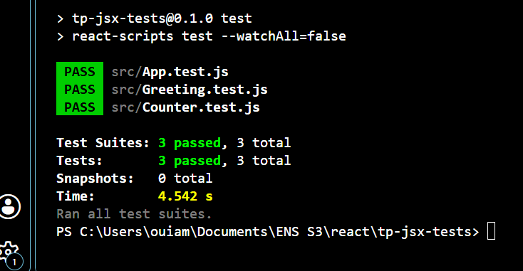

# TP 7 : Comprendre JSX, la composition avancée et les tests React

## 1. Structure du projet

Cette capture présente l’organisation des fichiers du projet React, notamment les composants et les fichiers de test créés pendant le TP.

## 2. Exploration de JSX

Cette capture montre l’affichage du titre JSX et du champ de saisie, en utilisant les bonnes pratiques de JSX, notamment className et htmlFor.\

## 3. Higher-Order Component (HOC)

Cette capture montre le composant Button enrichi par le HOC withLogging, avec l’affichage des props dans la console du navigateur.

## 4. Render Props

Cette capture présente la liste des noms Alice, Bob et Charlie, affichée à l’aide du composant DataLoader et du pattern Render Props.

## 5. Tests unitaires

Cette capture présente le résultat des tests unitaires du composant Greeting et du composant App.

## 6. Test d’intégration

Cette capture montre le résultat des tests après vérification de l’interaction avec le compteur Counter.

7. Exercice complémentaire : HOC avec timestamp

Cette capture présente le composant Button enrichi par le HOC withTimestamp, qui affiche la date et l’heure du rendu.

